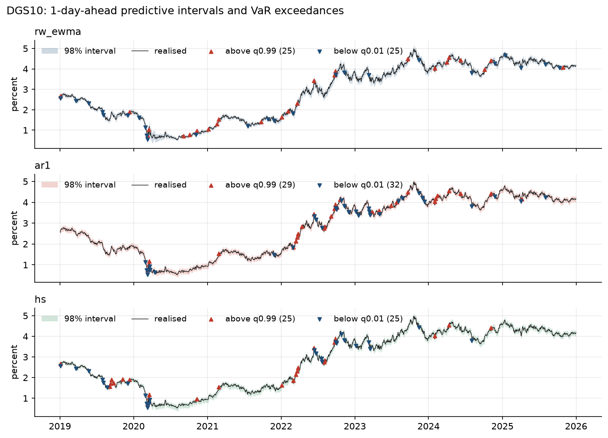
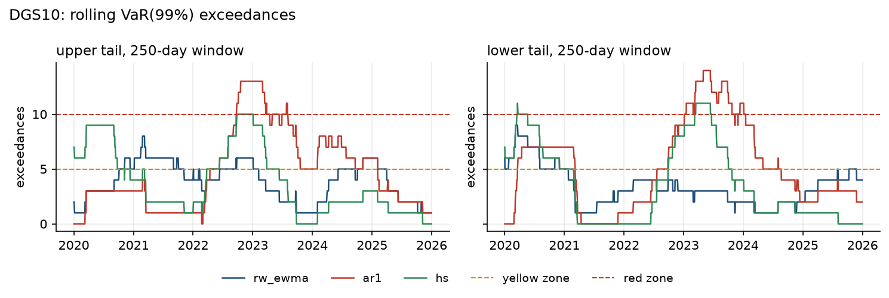

# TSFM-MRE

**A minimal, fully reproducible experiment for the risk-aware evaluation of time-series foundation models in finance.**

[](https://github.com/TonyLu786/tsfm-mre/actions/workflows/ci.yml)
[](pyproject.toml)
[](LICENSE)
[](https://doi.org/10.1145/3785706.3785728)

TSFM-MRE is the reference implementation of the risk-aware evaluation protocol introduced in
[*Time-Series Foundation Models in Finance: Pretraining Corpora, Architectures, Financial
Benchmarks, and Risk-Aware Evaluation*](https://doi.org/10.1145/3785706.3785728) (DECS 2025, ACM).
It brings the standards of quantitative risk management to forecast evaluation. Every model
is judged on its full predictive distribution, on the adequacy of its tails under
Basel-aligned backtests, and through comparisons that stay valid when many candidate
models are tested at once.

Generic forecasting benchmarks rank models by average accuracy, yet financial use is
decided in the tails: a forecaster that is sharp on average but understates extreme moves
fails the backtests that banks and supervisors apply. TSFM-MRE therefore treats
probabilistic accuracy and tail-risk adequacy as co-equal, first-class criteria. The
pipeline is model-agnostic. A foundation model, an econometric baseline or a
machine-learning forecaster enters through the same prediction table and is evaluated end
to end with a single command.

<p align="center">
  
</p>

## Highlights

- **Distribution-level evaluation.** Every forecast carries 21 predictive quantiles and the
  expected shortfall of both tails. Accuracy is scored by the CRPS, computed from its
  quantile representation, and by the tail quantile loss at the VaR levels; calibration is
  diagnosed by interval coverage and PIT histograms, randomised for yields quoted in basis
  points.
- **Basel-aligned risk backtesting.** Kupiec unconditional coverage, Christoffersen
  independence and conditional coverage, traffic-light zones derived exactly from the
  binomial distribution, and the Acerbi–Székely Z2 test of expected shortfall at the
  97.5% level of the revised market-risk standard, with Monte Carlo p-values.
- **Multiple-comparison-safe inference.** Diebold–Mariano tests with the
  Harvey–Leybourne–Newbold correction, White's Reality Check and Hansen's SPA test under
  the stationary bootstrap, so that a model is declared superior only after the search
  over candidate models is accounted for.
- **Real market data with an offline twin.** U.S. Treasury constant-maturity yields from
  the Federal Reserve H.15 release via FRED, cached with SHA-256 verification, and a
  synthetic panel calibrated to H.15 volatilities and correlations for fully offline
  replication.
- **Audit-grade reproducibility.** Configuration-driven runs, fixed seeds, byte-identical
  outputs across repeated runs, and a manifest that ties every result to the code commit,
  the software versions, the data provenance and the SHA-256 digest of each file. Numerical
  results are identical across Python 3.11 and 3.12 software stacks, and continuous
  integration covers Python 3.11 to 3.14 on Linux, Windows and macOS.
- **Verified statistics.** The test suite checks the size of each hypothesis test under
  its null, its power under alternatives, and the absence of look-ahead in every
  forecaster.

## Quick start

```bash
git clone https://github.com/TonyLu786/tsfm-mre.git
cd tsfm-mre
pip install -e .

tsfm-mre run configs/synthetic.yaml   # offline, about 10 seconds
tsfm-mre run configs/fred_h15.yaml    # downloads three H.15 series from FRED
```

Each run writes to `runs/<name>/`:

| Output | Content |
| :--- | :--- |
| `summary.md`, `report.html` | Tables and figures; the HTML report is self-contained |
| `metrics.csv` | CRPS, tail quantile loss, MAE, RMSE and interval coverage by model, series and horizon |
| `risk.csv` | VaR exceedances, Kupiec, Christoffersen and Basel results, and ES tests, by tail |
| `comparison_pairwise.csv`, `comparison_joint.csv` | Diebold–Mariano, Reality Check and SPA tests |
| `predictions/*.csv.gz` | Forecasts of every model in the prediction schema |
| `manifest.json` | Configuration, software versions, git commit and SHA-256 of all files |

## Reference results: U.S. Treasury yields

The reference experiment covers daily 3-month, 2-year and 10-year constant-maturity
yields from January 2003 to December 2025. Forecasts are issued at every trading day from
January 2019 to December 2025, which gives 1,749 one-day forecasts per maturity, and every
model is re-estimated at every origin. The complete tables are in
[`results/fred_h15`](results/fred_h15/summary.md); the offline counterpart on synthetic
data is in [`results/synthetic`](results/synthetic/summary.md).

CRPS in basis points, pooled over the three maturities (lower is better), with the change
relative to the benchmark. RC and SPA are p-values for the null hypothesis that no model
has a lower expected CRPS than the benchmark.

| Horizon (days) | rw_ewma (benchmark) | ar1 | hs | RC p | SPA p |
| ---: | ---: | ---: | ---: | ---: | ---: |
| 1 | 2.50 | 2.67 (+6.9%) | 2.59 (+3.6%) | 1.000 | 1.000 |
| 5 | 5.53 | 5.92 (+7.0%) | 5.81 (+4.9%) | 1.000 | 1.000 |
| 10 | 8.20 | 8.72 (+6.4%) | 8.74 (+6.6%) | 1.000 | 1.000 |
| 20 | 12.70 | 13.38 (+5.3%) | 13.92 (+9.6%) | 1.000 | 1.000 |

One-day 99% VaR exceedance rates for rising / falling yields; the nominal rate is 1%.

| Series | rw_ewma | ar1 | hs |
| :--- | ---: | ---: | ---: |
| DGS3MO | 2.3% / 2.3% | 1.6% / 0.9% | 1.7% / 2.1% |
| DGS2 | 1.5% / 1.8% | 2.9% / 3.1% | 1.8% / 2.2% |
| DGS10 | 1.4% / 1.4% | 1.7% / 1.8% | 1.4% / 1.4% |

Over seven years of daily data, the random walk with EWMA volatility remains the benchmark
to beat. Pooled over maturities, neither the AR(1) nor historical simulation improves on
it at any horizon, for CRPS or for tail quantile loss, and no gain at a single maturity is
significant under Reality Check or SPA (all p ≥ 0.2). At the same time, every baseline
breaches its 99% VaR more often than nominal overall, with its largest excess at the
3-month or 2-year maturity and a peak in 2022, the first year of the Federal Reserve's
tightening cycle. This is the gap a foundation model has to close: sharper predictive
distributions that remain calibrated in the tails.

<p align="center">
  
</p>

## Evaluating a foundation model

Forecasts enter through a prediction table with one row per model, series, origin and
horizon. Each row holds the predictive mean, 21 quantiles from 0.1% to 99.9% and the
expected shortfall at 1%, 2.5%, 97.5% and 99%; the full schema is in
[`docs/prediction_schema.md`](docs/prediction_schema.md). Models that produce sample
paths are summarised in one call:

```python
import pandas as pd
from tsfm_mre import summarize_samples, write_predictions
from tsfm_mre.schema import ES_COLUMNS, QUANTILE_COLUMNS

# samples: array (n_forecasts, n_draws) of predictive draws of y[t + h];
# series, origins, horizons, targets: one entry per forecast
mean, quantiles, es = summarize_samples(samples)
table = pd.DataFrame({"model": "my_tsfm", "series": series, "origin": origins,
                      "horizon": horizons, "target_date": targets, "mean": mean})
table[list(QUANTILE_COLUMNS)] = quantiles
table[list(ES_COLUMNS)] = es
write_predictions(table, "my_tsfm.csv.gz")
```

```bash
tsfm-mre validate my_tsfm.csv.gz
tsfm-mre run configs/fred_h15.yaml --predictions my_tsfm.csv.gz
```

The new model then appears in every table and figure and is tested against the
benchmark by Diebold–Mariano, Reality Check and SPA tests. The forecast origins and target
dates of a configuration are listed in the baseline files in `runs/<name>/predictions/`.

## Evaluation protocol

| Component | Implementation | Reference |
| :--- | :--- | :--- |
| Forecast design | Rolling origin, daily re-estimation, horizons of 1, 5, 10 and 20 trading days | |
| Accuracy | CRPS from predictive quantiles; tail quantile loss at the VaR levels | Gneiting and Raftery (2007); Laio and Tamea (2007); Gneiting and Ranjan (2011) |
| Calibration | Interval coverage; PIT, randomised for rounded observations | Gneiting, Balabdaoui and Raftery (2007); Czado, Gneiting and Held (2009) |
| VaR | Unconditional coverage; independence and conditional coverage; traffic-light zones | Kupiec (1995); Christoffersen (1998); Basel Committee (1996) |
| Expected shortfall | Z2 statistic with Monte Carlo p-values under the forecast distributions | Acerbi and Székely (2014) |
| Model comparison | Diebold–Mariano with HLN adjustment; Reality Check; SPA with stationary bootstrap | Diebold and Mariano (1995); Harvey, Leybourne and Newbold (1997); White (2000); Hansen (2005); Politis and Romano (1994) |

Formulas, conventions and the full reference list are in
[`docs/methodology.md`](docs/methodology.md); data sources and the synthetic generator are
described in [`docs/data.md`](docs/data.md).

### Baselines

| Model | Predictive distribution |
| :--- | :--- |
| `rw_ewma` | Random walk with RiskMetrics exponentially weighted volatility (decay 0.94) |
| `ar1` | Gaussian AR(1) estimated by least squares on an expanding window, with the exact multi-step distribution |
| `hs` | Historical simulation of h-day changes over a 500-day window |

## Repository layout

```text
configs/        experiment configurations (synthetic, fred_h15, smoke)
docs/           methodology, data, prediction schema, reproducibility
results/        reference results: summaries, tables, figures and manifests
scripts/        data description used in docs/data.md
src/tsfm_mre/   package: data, models, forecasting engine, scoring, backtests, comparison, reports
tests/          unit, calibration and end-to-end tests
```

## Reproducibility

`make reproduce` regenerates both reference result sets, and repeated runs reproduce every
table, forecast file and figure byte for byte. Each run records its configuration, data
provenance, software versions, git commit and the SHA-256 digest of every output in
`manifest.json`, so any number in `results/` can be traced to the exact code and data
that produced it. See [`docs/reproducibility.md`](docs/reproducibility.md).

## Citation

If you use TSFM-MRE, please cite the paper:

```bibtex
@inproceedings{lu2025tsfm,
  author    = {Lu, Juntong},
  title     = {Time-Series Foundation Models in Finance: Pretraining Corpora, Architectures,
               Financial Benchmarks, and Risk-Aware Evaluation},
  booktitle = {Proceedings of the 2025 2nd International Conference on Digital Economy and
               Computer Science},
  series    = {DECS 2025},
  pages     = {144--151},
  publisher = {Association for Computing Machinery},
  address   = {New York, NY, USA},
  year      = {2025},
  doi       = {10.1145/3785706.3785728}
}
```

Software citation metadata is provided in [`CITATION.cff`](CITATION.cff).

## License

Released under the [MIT License](LICENSE).
