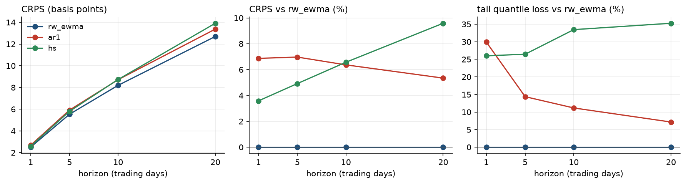
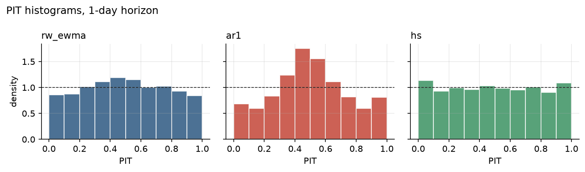

# TSFM-MRE results: fred_h15

| | |
| :--- | :--- |
| Data | FRED, H.15 Selected Interest Rates: market yield on U.S. Treasury securities at constant maturity, daily, percent |
| Series | DGS3MO, DGS2, DGS10 |
| Sample | 2003-01-02 to 2025-12-31 (5,753 trading days) |
| Forecast origins | 2019-01-02 to 2025-12-30, every trading day; models re-estimated at each origin |
| Horizons | 1, 5, 10, 20 trading days |
| Models | rw_ewma (benchmark), ar1, hs |

## Probabilistic accuracy

Continuous ranked probability score (basis points), pooled over series, with the change relative to the benchmark; lower is better. RC (White's Reality Check) and SPA (Hansen's test, consistent version) give p-values for the null hypothesis that no model has a lower expected loss than the benchmark.

| Horizon | rw_ewma (benchmark) | ar1 | hs | RC p | SPA p |
| ---: | ---: | ---: | ---: | ---: | ---: |
| 1 | 2.50 | 2.67 (+6.9%) | 2.59 (+3.6%) | 1.000 | 1.000 |
| 5 | 5.53 | 5.92 (+7.0%) | 5.81 (+4.9%) | 1.000 | 1.000 |
| 10 | 8.20 | 8.72 (+6.4%) | 8.74 (+6.6%) | 1.000 | 1.000 |
| 20 | 12.70 | 13.38 (+5.3%) | 13.92 (+9.6%) | 1.000 | 1.000 |

## Tail accuracy

Tail quantile loss at the two VaR levels (basis points), pooled over series, with the change relative to the benchmark; lower is better. RC (White's Reality Check) and SPA (Hansen's test, consistent version) give p-values for the null hypothesis that no model has a lower expected loss than the benchmark.

| Horizon | rw_ewma (benchmark) | ar1 | hs | RC p | SPA p |
| ---: | ---: | ---: | ---: | ---: | ---: |
| 1 | 0.16 | 0.21 (+29.9%) | 0.21 (+26.0%) | 1.000 | 1.000 |
| 5 | 0.40 | 0.46 (+14.4%) | 0.51 (+26.5%) | 0.998 | 1.000 |
| 10 | 0.66 | 0.73 (+11.2%) | 0.87 (+33.5%) | 0.964 | 1.000 |
| 20 | 1.08 | 1.16 (+7.2%) | 1.46 (+35.3%) | 0.892 | 1.000 |

## Calibration

Empirical coverage of central predictive intervals and point accuracy at the 1-day horizon, pooled over series (median for MAE, mean for RMSE).

| Model | 80% interval | 90% interval | 98% interval | MAE (bp) | RMSE (bp) |
| :--- | ---: | ---: | ---: | ---: | ---: |
| rw_ewma | 81.9% | 90.1% | 96.4% | 3.44 | 5.27 |
| ar1 | 84.9% | 90.6% | 96.0% | 3.45 | 5.27 |
| hs | 79.1% | 88.2% | 96.5% | 3.45 | 5.28 |

## Risk backtests

1-day VaR at level 99% and ES at level 97.5%. The upper tail is the loss from rising yields, the lower tail the loss from falling yields. Kupiec: unconditional coverage; CC: Christoffersen conditional coverage; ES: Acerbi–Székely Z2 with Monte Carlo p-value (negative Z2 signals underestimated tail risk).

| Series | Tail | Model | Exceedances | Rate | Kupiec p | CC p | Basel zone (last 250) | ES Z2 | ES p |
| :--- | :--- | :--- | ---: | ---: | ---: | ---: | ---: | ---: | ---: |
| DGS3MO | upper | rw_ewma | 40 / 1749 | 2.3% | <0.001 | <0.001 | yellow (5) | -0.62 | <0.001 |
| DGS3MO | upper | ar1 | 28 / 1749 | 1.6% | 0.020 | 0.043 | green (0) | -0.10 | 0.260 |
| DGS3MO | upper | hs | 30 / 1749 | 1.7% | 0.006 | 0.007 | green (3) | -0.47 | 0.003 |
| DGS3MO | lower | rw_ewma | 40 / 1749 | 2.3% | <0.001 | <0.001 | yellow (6) | -0.55 | <0.001 |
| DGS3MO | lower | ar1 | 15 / 1749 | 0.9% | 0.540 | <0.001 | green (0) | +0.41 | 0.999 |
| DGS3MO | lower | hs | 37 / 1749 | 2.1% | <0.001 | <0.001 | green (3) | -0.67 | <0.001 |
| DGS2 | upper | rw_ewma | 26 / 1749 | 1.5% | 0.056 | 0.114 | green (3) | -0.23 | 0.074 |
| DGS2 | upper | ar1 | 51 / 1749 | 2.9% | <0.001 | <0.001 | green (3) | -1.19 | <0.001 |
| DGS2 | upper | hs | 31 / 1749 | 1.8% | 0.003 | 0.012 | green (1) | -0.52 | <0.001 |
| DGS2 | lower | rw_ewma | 31 / 1749 | 1.8% | 0.003 | <0.001 | green (2) | -0.57 | <0.001 |
| DGS2 | lower | ar1 | 54 / 1749 | 3.1% | <0.001 | <0.001 | green (2) | -1.48 | <0.001 |
| DGS2 | lower | hs | 38 / 1749 | 2.2% | <0.001 | <0.001 | green (2) | -0.65 | <0.001 |
| DGS10 | upper | rw_ewma | 25 / 1749 | 1.4% | 0.090 | 0.165 | green (1) | -0.14 | 0.187 |
| DGS10 | upper | ar1 | 29 / 1749 | 1.7% | 0.012 | 0.010 | green (1) | -0.35 | 0.015 |
| DGS10 | upper | hs | 25 / 1749 | 1.4% | 0.090 | 0.159 | green (0) | -0.33 | 0.011 |
| DGS10 | lower | rw_ewma | 25 / 1749 | 1.4% | 0.090 | 0.154 | green (4) | -0.19 | 0.116 |
| DGS10 | lower | ar1 | 32 / 1749 | 1.8% | 0.002 | <0.001 | green (2) | -0.36 | 0.014 |
| DGS10 | lower | hs | 25 / 1749 | 1.4% | 0.090 | 0.033 | green (0) | -0.41 | 0.005 |

## Figures

