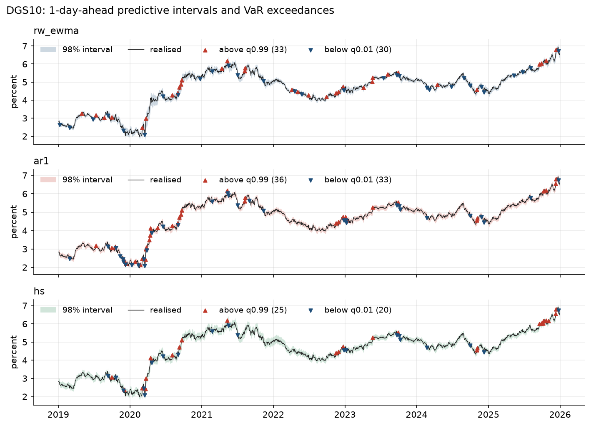
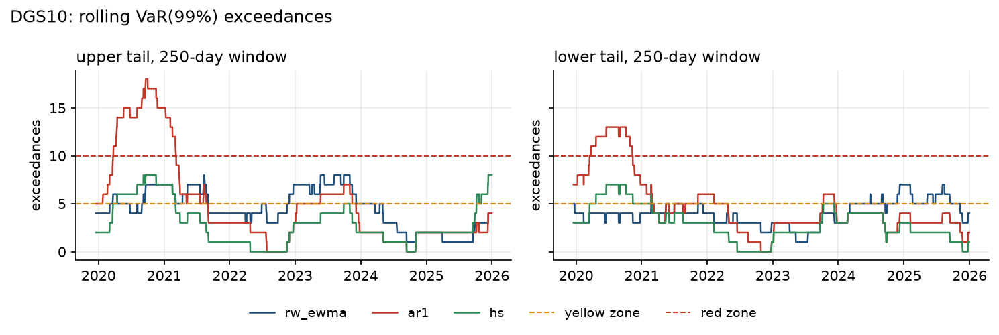
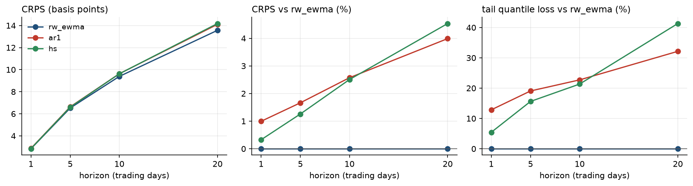
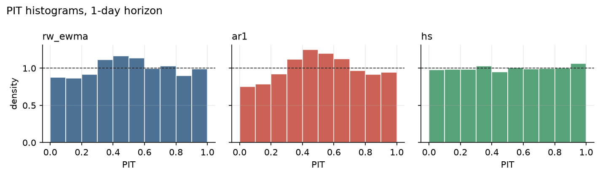

# TSFM-MRE results: synthetic

| | |
| :--- | :--- |
| Data | Nelson-Siegel three-factor model with GARCH(1,1) Student-t shocks, stress episodes and a smooth zero floor, calibrated to daily H.15 dynamics |
| Series | DGS3MO, DGS2, DGS10 |
| Sample | 2003-01-01 to 2025-12-31 (6,001 trading days) |
| Forecast origins | 2019-01-02 to 2025-12-30, every trading day; models re-estimated at each origin |
| Horizons | 1, 5, 10, 20 trading days |
| Models | rw_ewma (benchmark), ar1, hs |

## Probabilistic accuracy

Continuous ranked probability score (basis points), pooled over series, with the change relative to the benchmark; lower is better. RC (White's Reality Check) and SPA (Hansen's test, consistent version) give p-values for the null hypothesis that no model has a lower expected loss than the benchmark.

| Horizon | rw_ewma (benchmark) | ar1 | hs | RC p | SPA p |
| ---: | ---: | ---: | ---: | ---: | ---: |
| 1 | 2.83 | 2.86 (+1.0%) | 2.84 (+0.3%) | 0.847 | 1.000 |
| 5 | 6.52 | 6.63 (+1.7%) | 6.60 (+1.3%) | 0.985 | 1.000 |
| 10 | 9.39 | 9.63 (+2.6%) | 9.62 (+2.5%) | 0.998 | 1.000 |
| 20 | 13.57 | 14.11 (+4.0%) | 14.18 (+4.5%) | 1.000 | 1.000 |

## Tail accuracy

Tail quantile loss at the two VaR levels (basis points), pooled over series, with the change relative to the benchmark; lower is better. RC (White's Reality Check) and SPA (Hansen's test, consistent version) give p-values for the null hypothesis that no model has a lower expected loss than the benchmark.

| Horizon | rw_ewma (benchmark) | ar1 | hs | RC p | SPA p |
| ---: | ---: | ---: | ---: | ---: | ---: |
| 1 | 0.19 | 0.21 (+12.8%) | 0.20 (+5.4%) | 0.948 | 1.000 |
| 5 | 0.39 | 0.47 (+19.1%) | 0.45 (+15.6%) | 0.985 | 1.000 |
| 10 | 0.54 | 0.66 (+22.7%) | 0.65 (+21.4%) | 0.994 | 1.000 |
| 20 | 0.81 | 1.08 (+32.2%) | 1.15 (+41.3%) | 0.984 | 1.000 |

## Calibration

Empirical coverage of central predictive intervals and point accuracy at the 1-day horizon, pooled over series (median for MAE, mean for RMSE).

| Model | 80% interval | 90% interval | 98% interval | MAE (bp) | RMSE (bp) |
| :--- | ---: | ---: | ---: | ---: | ---: |
| rw_ewma | 81.3% | 89.6% | 96.4% | 3.89 | 5.55 |
| ar1 | 83.0% | 90.2% | 96.3% | 3.89 | 5.57 |
| hs | 79.5% | 90.0% | 97.8% | 3.90 | 5.57 |

## Risk backtests

1-day VaR at level 99% and ES at level 97.5%. The upper tail is the loss from rising yields, the lower tail the loss from falling yields. Kupiec: unconditional coverage; CC: Christoffersen conditional coverage; ES: Acerbi–Székely Z2 with Monte Carlo p-value (negative Z2 signals underestimated tail risk).

| Series | Tail | Model | Exceedances | Rate | Kupiec p | CC p | Basel zone (last 250) | ES Z2 | ES p |
| :--- | :--- | :--- | ---: | ---: | ---: | ---: | ---: | ---: | ---: |
| DGS3MO | upper | rw_ewma | 40 / 1825 | 2.2% | <0.001 | <0.001 | yellow (5) | -0.66 | <0.001 |
| DGS3MO | upper | ar1 | 50 / 1825 | 2.7% | <0.001 | <0.001 | green (2) | -1.17 | <0.001 |
| DGS3MO | upper | hs | 21 / 1825 | 1.2% | 0.528 | 0.411 | green (2) | -0.18 | 0.088 |
| DGS3MO | lower | rw_ewma | 30 / 1825 | 1.6% | 0.011 | 0.033 | green (3) | -0.16 | 0.142 |
| DGS3MO | lower | ar1 | 28 / 1825 | 1.5% | 0.033 | 0.067 | green (3) | -0.64 | <0.001 |
| DGS3MO | lower | hs | 19 / 1825 | 1.0% | 0.861 | 0.806 | green (1) | -0.11 | 0.172 |
| DGS2 | upper | rw_ewma | 26 / 1825 | 1.4% | 0.087 | 0.158 | green (3) | -0.44 | 0.004 |
| DGS2 | upper | ar1 | 27 / 1825 | 1.5% | 0.055 | 0.028 | green (2) | -0.17 | 0.128 |
| DGS2 | upper | hs | 17 / 1825 | 0.9% | 0.766 | 0.337 | green (4) | +0.13 | 0.779 |
| DGS2 | lower | rw_ewma | 37 / 1825 | 2.0% | <0.001 | <0.001 | green (4) | -0.59 | <0.001 |
| DGS2 | lower | ar1 | 27 / 1825 | 1.5% | 0.055 | 0.113 | green (4) | -0.23 | 0.067 |
| DGS2 | lower | hs | 19 / 1825 | 1.0% | 0.861 | 0.806 | green (4) | +0.07 | 0.640 |
| DGS10 | upper | rw_ewma | 33 / 1825 | 1.8% | 0.002 | 0.007 | green (4) | -0.52 | 0.003 |
| DGS10 | upper | ar1 | 36 / 1825 | 2.0% | <0.001 | <0.001 | green (4) | -0.86 | <0.001 |
| DGS10 | upper | hs | 25 / 1825 | 1.4% | 0.133 | 0.044 | yellow (8) | -0.11 | 0.199 |
| DGS10 | lower | rw_ewma | 30 / 1825 | 1.6% | 0.011 | 0.025 | green (4) | -0.29 | 0.031 |
| DGS10 | lower | ar1 | 33 / 1825 | 1.8% | 0.002 | 0.007 | green (2) | -0.45 | <0.001 |
| DGS10 | lower | hs | 20 / 1825 | 1.1% | 0.685 | 0.738 | green (1) | +0.03 | 0.549 |

## Figures

